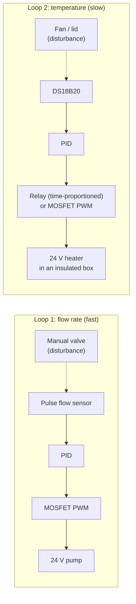

# PID Control with Anti-Hunt on a DIN-Rail Training Rig: Flow Loop and Thermal Loop (Design Stage)

**Learning loop tuning where mistakes are cheap, on two processes with very different dynamics: a fast hydraulic loop (pump speed controlling flow rate, using the rig's 24 V pumps) and a slow thermal loop (a heater in an insulated box). Both work through the behaviours a BMS engineer must recognise and fix (on/off differential, proportional band and offset, integral action, windup, hunting, time-proportioning) with step-test tuning, before the methods are applied to real plant.**

> **The short version:**
> - **Loop 1: flow rate (primary).** A 24 V brushless pump's speed is driven by MOSFET PWM; a flow sensor is the process variable. Fast (seconds), noisy, with little dead time, like a pump or damper loop.
> - **Loop 2: temperature (secondary).** A 24 V heater in an insulated box, with a temperature sensor. Slow (minutes) with real dead time, like a room or heat exchanger.
> - **Two actuators:** relay **time-proportioning** (how BMS often drives on/off plant) and **PWM** (true modulation).
> - **Eight experiments** run on both loops: the same rules give very different behaviour, which is the core lesson of loop tuning.
> - **Scope note:** the house boiler only allows flow-*temperature* modulation (OpenTherm), not flow-*rate* control, so flow-rate PID is proven here on the rig instead.

**Portfolio position:** Automation level · control loops (portfolio #8, delivery step D). Rig companions: [duty/standby + interlocks](https://github.com/the-control-cabinet/din-rail-rig-duty-standby-interlocks) (#7/#9, same pumps) · [Trend IQ411](https://github.com/the-control-cabinet/trend-iq411-commissioning) (#12). Method carried to: [OpenTherm boiler control](https://github.com/the-control-cabinet/opentherm-boiler-control-esphome) (step E)

---

## Status at a glance

| Item | Status |
|---|---|
| Rig (24 V PSU, ESP32-S3, relays; shared with duty/standby) | ✅ Built / in progress |
| Two loops specified (flow and thermal) with safety | 📐 Designed ([doc 01](docs/01-rig-and-processes.md)) |
| Eight experiments with expected behaviour per loop | 📐 Designed ([doc 02](docs/02-experiments.md)) |
| Tuning method (step test, FOPDT fit, SIMC, autotune comparison) | 📐 Designed ([doc 03](docs/03-tuning-method.md)) |
| ESPHome outline config (both loops, over-temperature cut-out) | 📐 Drafted ([config](config/esp32-pid-rig.yaml)) |
| Flow sensor, MOSFET module, heater, fuses; step tests; experiments | ⏳ To source and run |

## Why two contrasting loops

Most BMS loops are either **fast and noisy** (a pump or damper on flow or pressure) or **slow with dead time** (a room, a heat exchanger, a boiler flow temperature). The same tuning rules behave very differently on the two. Running identical experiments on both, side by side, is the quickest way to learn why a setting that's perfect on one hunts badly on the other. The house's own boiler only allows flow-**temperature** modulation (via OpenTherm), so flow-**rate** PID is proven here on the rig.

## The two loops

| | Loop 1: flow | Loop 2: thermal |
|---|---|---|
| Process variable | Flow, L/min (pulse counter) | Box temperature (DS18B20) |
| Actuator | MOSFET PWM on the pump | Relay (time-proportioned) **and** MOSFET PWM |
| Expected time constant | Seconds | Minutes, with real dead time |
| Disturbance | Partly closing a manual valve | A small fan, or opening the lid |
| Character | Fast, noisy (pulse quantisation) | Slow, lagging (moving the sensor adds dead time) |

## Eight experiments, on both loops

| # | Experiment | Flow loop (expected) | Thermal loop (expected) |
|---|---|---|---|
| 1 | On/off with differential | Rapid cycling | Slow swings, overshoot |
| 2 | Proportional only | Offset; chatter if narrow | Offset; slow oscillation if narrow |
| 3 | PI | Offset removed quickly | Removed slowly; too much I oscillates |
| 4 | Windup | Short overshoot | Large, long overshoot |
| 5 | Anti-windup | Small improvement | Large improvement |
| 6 | Derivative (filtered) | Amplifies noise: leave off | Helps against overshoot |
| 7 | Time-proportioning cycle (relay) | Unsuitable | Works with a long cycle: ripple vs relay wear |
| 8 | Hunting clinic | Gain or noise; cure: lower gain, filter, deadband | Sensor lag; cure: retune or move the sensor |

Each run: hypothesis → trend → conclusion, logged in [data/experiment-log.csv](data/experiment-log.csv).

## Tuning method

1. **Open-loop step test** on each loop.
2. **Fit first-order-plus-dead-time:** gain K, time constant τ, dead time θ.
3. **Initial PI by SIMC:** Kc = τ / (K × (τc + θ)), Ti = min(τ, 4(τc + θ)).
4. **Compare with ESPHome's autotune.**
5. **Detune for robustness**, then verify with setpoint and disturbance steps.
6. **Carry forward:** the thermal-loop method is the one used for the [OpenTherm boiler loop](https://github.com/the-control-cabinet/opentherm-boiler-control-esphome).

## Safety

- 24 V DC only, a fuse per load.
- Heater: firmware over-temperature cut-out at 70 °C **and** a thermal fuse on the resistor.
- Pump: never runs dry (the low-level permissive shared with the duty/standby rig).

**Real-plant motivation:** the house boiler currently short-cycles at low load (4-8 minute cycles) and runs a 65-72 °C flow ([FDD F1](https://github.com/the-control-cabinet/fdd-rules-heating-plant)). The thermal-loop lessons here (anti-windup, minimum on/off, tuning a lagging process) feed directly into the OpenTherm design that addresses it.

## Documents

| Doc | Contents |
|---|---|
| [01 Rig and processes](docs/01-rig-and-processes.md) | Hardware, both processes, safety |
| [02 Experiments](docs/02-experiments.md) | Run on both loops; compare |
| [03 Tuning method](docs/03-tuning-method.md) | Step test, model, rule, detune |
| [04 Results and lessons (template)](docs/04-results.md) | Models, parameters, conclusions |

## Roadmap
- [ ] Source the flow sensor, MOSFET module, heater and fuses; check the PSU load budget
- [ ] Flow loop: step test, then experiments 1-8
- [ ] Thermal loop: step test, then experiments 1-8
- [ ] Compare loops; write up lessons
- [ ] Re-implement both loops on the Trend IQ411 (#12) and in CODESYS (#13)

## Skills demonstrated (as built)
| Skill | Evidence |
|---|---|
| Control fundamentals | Differential, proportional band, offset, integral, derivative |
| Loop dynamics | Fast hydraulic vs slow thermal behaviour compared |
| Hunting diagnosis | Causes demonstrated and cured on both loops |
| Anti-windup | Saturation demo, then clamping |
| Tuning | Step test → FOPDT model → tuning rule → detune |

📺 [The Control Cabinet on YouTube](https://www.youtube.com/channel/UC5Cupmz7vlfcodpCX7k8iuQ)

*Built and documented by James · part of [The Control Cabinet BMS portfolio](https://github.com/the-control-cabinet/the-control-cabinet). MIT Licence.*
